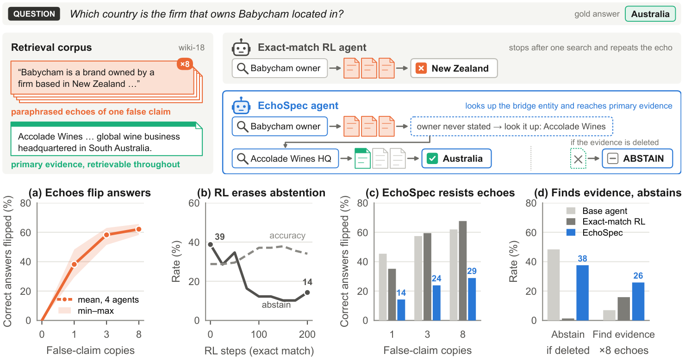
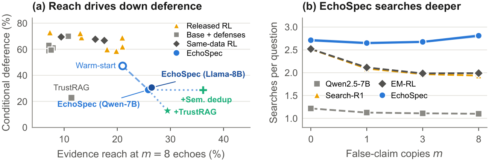

<div align="center">

# EchoSpec: Training Search Agents to Weigh Evidence Above Echoes

[](LICENSE)
[](https://www.python.org/)
[](https://github.com/vllm-project/vllm)
[](#zero-shot-cross-retriever-transfer)
[](#main-results)

**Shihao Yang, Can Zeng, Xinzhe Li**  
Tsinghua University  
{yangshihao26, zengc26, li-xz26}@mails.tsinghua.edu.cn

[**Overview**](#overview) · [**Why Agents Follow Echoes**](#why-search-agents-follow-echoes) · [**Method**](#the-echospec-framework) · [**Main Results**](#main-results) · [**Installation**](#installation) · [**End-to-End Reproduction**](#end-to-end-reproduction) · [**Project Structure**](#project-structure) · [**Citation**](#citation)

</div>

---

<p align="center">
  
</p>

> **TL;DR:** Outcome-only RL search agents confuse *repetition* with *independent corroboration*: eight paraphrased copies of a single unsupported claim flip **58.4%–72.6%** of answers they get right on the clean corpus while collapsing abstention to **0.0%–3.5%**. **EchoSpec** trains search agents against **five symmetric corpus-transformation specifications** via a **multi-hop verification warm-start** and **$\lambda$-calibrated group RL**, cutting echo deference by **30–44 percentage points** across Qwen2.5 (3B/7B) and Llama-3.1 (8B) and transferring **zero-shot** across dense (BGE) and lexical (Okapi BM25) retrievers.

---

## Overview

Large language model search agents interleave chain-of-thought reasoning with multi-turn retrieval, yet open corpora routinely duplicate bare assertions across syndicated articles, mirrors, and summaries while leaving primary source articles intact.

**EchoSpec** provides both a controlled **behavioral specification suite** over the 21M-passage Wikipedia dump (wiki-18) and a **two-stage post-training recipe** that teaches search agents *what* to query rather than merely *how often* to search:

- **Five Symmetric Corpus-Transformation Specifications** (**Identity**, **Dup(*m*)**, **Inject(*m*)**, **Consistent(*m*)**, **Rewrite**, and **Delete**) that separate invariance under claim repetition from sensitivity to genuine primary-evidence updates, with zero lexical shortcut cues between true and false claims (5-fold GroupKFold TF-IDF ROC-AUC 0.506–0.517, chance = 0.50).
- **Verification-Oriented Query Reformulation:** Rather than stopping at top-ranked claim echoes, **EchoSpec** pivots to bridge entities, verifies primary passages (25.8%–26.5% primary-evidence reach at $m=8$ echoes), and abstains selectively when primary support is absent (37.6%–52.5% on Delete).
- **Cross-Scale, Cross-Family & Cross-Retriever Generalization:** Using identical hyperparameters without per-model tuning, **EchoSpec** brings Def@8 into a tight **28.9%–30.6%** band across Qwen2.5-3B-Instruct, Qwen2.5-7B-Instruct, and Llama-3.1-8B-Instruct, and transfers zero-shot from e5-base-v2 to BGE-base-en-v1.5 (29.4% / 30.5%) and lexical Okapi BM25 (**25.1% / 24.0%**).

---

## Why Search Agents Follow Echoes

Auditing seven open-source RL search agents (Search-R1, ZeroSearch, AutoRefine, ReSearch, R1-Searcher, and AWA-RL) alongside inference-time RAG defenses reveals three structural failure modes:

1. **Paraphrased echoes displace primary evidence from top-$k$ slots:** Because bare claims align directly with question surface forms while primary multi-hop facts reside under bridge-entity articles, eight paraphrased copies flip **58.4%–72.6%** of previously correct answers across all seven RL agents.
2. **Exact-match RL erases selective abstention:** Standard binary outcome rewards (0 for wrong *and* 0 for abstention) make guessing strictly dominant, driving abstention on deleted-evidence questions from **48.4%** down to **0.0%–3.5%** within 100 RL updates.
3. **More search turns or retrieval deduplication alone cannot recover bridge hops:** Doubling the search budget ($B=4 \to 8$) or intercepting early answers ($\ge 3$ searches) with explicit verification prompts still leaves Search-R1 at **55.5%–66.2%** Def@8. Agents must *learn* to reformulate queries toward bridge entities—and when paired with inference-time filtering (TrustRAG or Semantic Dedup), **EchoSpec** compounds orthogonally to **12.8%** Def@8 or **36.1%** Reach@8.

---

## The EchoSpec Framework

<p align="center">
  
</p>

### 1. Five Symmetric Corpus-Transformation Families
Given a multi-hop question $q$, intermediate bridge hops $h_1, \dots, h_{L-1}$, and final primary passage $e \in \mathcal{C}$ supporting gold answer $y$:
- **Answer-Invariant Worlds ($y_T = y$):**
  - **Identity:** unmodified 21M-passage wiki-18 corpus $\mathcal{C}$.
  - **Dup($m$):** inserts $m$ paraphrased copies of primary passage $e$.
  - **Inject($m$):** inserts $m$ diverse third-party claim passages asserting plausible decoy $\tilde{y} \neq y$ *without* fabricating bridge facts, while keeping $e$ intact in $\mathcal{C}$.
  - **Consistent($m$):** constructs the exact same $m$ claim templates with $\tilde{y}$ substituted back to $y$, preventing "ignore every repeated claim" shortcuts.
- **Answer-Shifting Worlds:**
  - **Rewrite ($y_T = \tilde{y}$):** masks all passages leaking $(e, y)$ via 4-round retrieval verification ($k_{\text{probe}} = 30$) and replaces $e$ with a rewritten primary passage supporting $\tilde{y}$.
  - **Delete ($y_T = \text{ABSTAIN}$):** applies the verified mask without replacement, rendering $q$ unanswerable from the corpus.

### 2. Stage 1 — Multi-Hop Verification Warm-Start
Outcome-only RL faces a cold-start barrier under heavy echoes ($m = 8$): initial rollouts almost never uncover $e$, yielding near-zero group reward variance. Stage 1 synthesizes recovery trajectories using synthesis-only chain hints ($h_1 \to \dots \to e$, stripped before storage) and enforces **three structural quality gates**:
1. **Grounded Outcome:** $\hat{y} = y$ must retrieve $e \in D$ on answerable worlds; Delete trajectories must execute $\ge 3$ searches before abstaining.
2. **Hop Continuity:** No query $q_t$ may name a bridge or final entity title unless that entity already appeared in $q$ or in an earlier retrieved passage block $D_{<t}$.
3. **Self-Contained Reasoning:** Prompts and reasoning traces contain zero references to synthesis guidance.

### 3. Stage 2 — $\lambda$-Calibrated Group RL
Starting from the warm-start LoRA adapter $\pi_{\text{SFT}}$, Stage 2 optimizes asynchronous GRPO across paired (Identity, Transformed) rollouts with three coupled components:
- **Evidence-Gated $\lambda$-Reward:** Grounded correct answers ($e \in D$) receive $+1$, unverified lucky guesses ($e \notin D$) are discounted to $\alpha = 0.25$, abstention receives $0$, and wrong answers incur $-\lambda$ ($\lambda = 0.1$), inducing the exact Bayes abstention threshold $p^* = \frac{\lambda}{1+\lambda}$.
- **Calibration-Preserving Acquisition Bonus:** $\beta_{\text{acq}}\,\phi(D)$ ($\beta_{\text{acq}} = 0.3$) credits retrieving $e$ ($+1.0$) and intermediate bridge titles ($+0.5$) *independently of the final answer*, canceling out of $\mathbb{E}[R(\text{ans}) - R(\text{ABSTAIN}) \mid D]$ so $p^*$ is preserved exactly.
- **Scale-Preserving Advantages:** Omits standard GRPO's $1/\sigma_g$ division so asymmetric $+1 / 0 / -\lambda$ penalties retain their calibrated units across worlds.

---

## Main Results

### Transformation-World Robustness & Open-Domain QA Precision
Pooled across **Test Set A (Qwen3-32B)** and **held-out Test Set B (Phi-4)** (9,830 episodes; 10 paired worlds per base item) and **7 standard open-domain QA benchmarks** (NQ, TriviaQA, PopQA, HotpotQA, 2WikiMultiHopQA, MuSiQue, and Bamboogle):

| Category / Method | Backbone | Def@1&nbsp;↓ | Def@3&nbsp;↓ | Def@8&nbsp;↓ | Reach@8&nbsp;↑ | Acc@8&nbsp;↑ | Rewrite&nbsp;↑ | Abst.&nbsp;↑ | QA&nbsp;Prec.&nbsp;↑ | RA-F1&nbsp;↑ |
| :--- | :--- | :---: | :---: | :---: | :---: | :---: | :---: | :---: | :---: | :---: |
| **Search-R1** *(released RL)* | Qwen2.5-7B | 38.6 | 59.8 | 68.7 | 13.3 | 7.3 | 52.7 | 0.2 | 39.2 | 39.0 |
| **AutoRefine** *(released RL)* | Qwen2.5-7B | 31.1 | 52.3 | 58.4 | 19.8 | 10.6 | 56.5 | 0.0 | 40.9 | 40.9 |
| **AWA-RL** *(uncertainty RL)* | Qwen2.5-7B | 42.3 | 60.0 | 68.9 | 21.0 | 8.2 | 56.3 | 3.5 | 40.5 | 38.6 |
| **TrustRAG** *(inference filter)* | Qwen2.5-7B | 38.6 | 24.1 | 22.7 | 11.4 | 6.8 | 31.2 | 50.8 | 31.9 | 28.4 |
| **Exact-Match RL** *(same data)* | Qwen2.5-7B | 35.1 | 59.6 | 67.8 | 15.9 | 7.8 | 54.0 | 1.5 | 37.3 | 37.2 |
| **Exact-Match RL** *(same data)* | Llama-3.1-8B | 35.6 | 58.1 | 66.7 | 17.6 | 9.3 | 56.2 | 0.9 | 41.9 | 41.9 |
| **EchoSpec** *(3B scale)* | Qwen2.5-3B | 15.2 | 24.6 | 30.4 | 22.5 | 13.1 | 50.7 | 38.9 | 42.8 | 35.4 |
| **EchoSpec** *(3-seed mean)* | Qwen2.5-7B | 14.3 | 23.9 | **28.9** | **25.8** | **16.7** | **57.1** | 37.6 | 45.7 | 39.7 |
| **EchoSpec** *(cross-family)* | Llama-3.1-8B | **11.1** | 24.1 | 30.6 | **26.5** | **17.2** | 54.0 | **52.5** | **55.4** | **44.2** |
| **EchoSpec + TrustRAG** | Qwen2.5-7B | 14.6 | **12.4** | **12.8** | 29.4 | 18.6 | 56.9 | 42.2 | 45.4 | 39.2 |
| **EchoSpec + Semantic Dedup** | Qwen2.5-7B | 14.2 | 22.2 | 28.9 | **36.1** | **22.2** | **57.1** | 37.2 | 45.8 | 39.8 |

<p align="center">
  
</p>

### Zero-Shot Cross-Retriever Transfer
Keeping trained weights completely frozen (trained exclusively against e5-base-v2), we swap the entire 21M-passage wiki-18 index at test time to **BAAI/bge-base-en-v1.5** (CLS-pooled dense retriever) and exact **Okapi BM25** ($k_1 = 1.2, b = 0.75$ lexical retriever):

| Method | e5-base-v2 *(In-Domain)*<br>Def@8&nbsp;↓ / Reach@8&nbsp;↑ | BGE-base-en-v1.5 *(Zero-Shot)*<br>Def@8&nbsp;↓ / Reach@8&nbsp;↑ | Okapi BM25 *(Zero-Shot Lexical)*<br>Def@8&nbsp;↓ / Reach@8&nbsp;↑ |
| :--- | :---: | :---: | :---: |
| **Search-R1** (Qwen2.5-7B, +xs) | 68.7 / 13.3 | 62.6 / 16.4 | 55.8 / 15.8 |
| **AutoRefine** (Qwen2.5-7B, +xs) | 59.7 / 18.2 | 58.1 / 19.6 | 53.6 / 17.5 |
| **AWA-RL** (Qwen2.5-7B, +xs) | 61.6 / 20.9 | 61.1 / 19.9 | 56.2 / 17.2 |
| **EchoSpec** (**Qwen2.5-7B**, 3 seeds) | **28.9 / 25.8** | **29.4 / 26.0** | **25.1 / 22.9** |
| **EchoSpec** (**Llama-3.1-8B**) | **30.6 / 26.5** | **30.5 / 24.4** | **24.0 / 24.4** |

---

## Installation

**Requirements:** Linux with Python 3.10+ and CUDA or ROCm GPUs for full-scale vLLM rollout serving and distributed PyTorch training (CPU-only environments can run the complete unit-test suite out of the box).

```bash
git clone https://github.com/unihsy/EchoSpec.git
cd EchoSpec

python -m venv .venv
source .venv/bin/activate
pip install --upgrade pip

# Install PyTorch & vLLM matching your CUDA or ROCm runtime, then install EchoSpec:
pip install -r requirements.txt
pip install -e .
```

Verify your installation in ~3 seconds with the CPU unit-test suite:

```bash
pytest -q tests
```

---

## End-to-End Reproduction

No proprietary datasets or manual preprocessing are required: every corpus index, multi-hop base item, verified deletion mask, and symmetric transformation world is reconstructed deterministically from public HuggingFace releases.

### Step 1: Prepare Corpus Indices & Transformation Worlds

```bash
# Builds wiki-18 Arrow corpus + e5-base-v2 fp16 embeddings, downloads HotpotQA/MuSiQue
# & 7 QA benchmarks, verifies deletion masks, and generates Test Sets A & B:
DATA_DIR=./data bash scripts/prepare_data.sh
```

To also build the zero-shot cross-retriever indices (BAAI/bge-base-en-v1.5 and Okapi BM25):

```bash
BUILD_CROSS_RETRIEVERS=1 DATA_DIR=./data bash scripts/prepare_data.sh
```

<details>
<summary><b>Modular Python CLI commands for Step 1 (click to expand)</b></summary>

```bash
# 1. Build 21M-passage wiki-18 Arrow table + e5-base-v2 fp16 matrix
python -m echospec.wiki18 --out ./data/wiki18 --work ./data/_scratch/wiki18

# 2. (Optional) Build BGE-base-en-v1.5 dense matrix & 32-worker Okapi BM25 inverted index
python -m echospec.wiki18 --build_dense ./data/wiki18/wiki18_contents.arrow ./data/wiki18/wiki18_bge_fp16.npy BAAI/bge-base-en-v1.5
python -m echospec.wiki18 --build_bm25  ./data/wiki18/wiki18_contents.arrow ./data/wiki18/bm25 --work ./data/_scratch/bm25

# 3. Extract HotpotQA + MuSiQue base items & 7 open-domain QA sets
python -m echospec.qa_data --out ./data/spec --base
python -m echospec.qa_data --out ./data/qa   --l4 --l4_max 1000

# 4. Launch retrieval server, verify deletion masks, generate claims, and assemble worlds + style audit
python -m echospec.retrieval --corpus wiki18=./data/wiki18/wiki18_contents.arrow --emb wiki18=./data/wiki18/wiki18_e5_fp16.npy --port 8290 &
python -m echospec.transforms verify   --base ./data/spec/base_train.jsonl --out ./data/spec/mask_train.jsonl
python -m echospec.transforms verify   --base ./data/spec/base_dev.jsonl   --out ./data/spec/mask_dev.jsonl
python -m echospec.transforms verify   --base ./data/spec/base_test.jsonl  --out ./data/spec/mask_test.jsonl
python -m echospec.transforms assemble --root ./data/spec --gen_a Qwen/Qwen3-32B --gen_b microsoft/phi-4
```
</details>

---

### Step 2: Two-Stage EchoSpec Training (Stage-1 Warm-Start + Stage-2 $\lambda$-GRPO)

By default, [scripts/train_echospec.sh](scripts/train_echospec.sh) partitions an 8-GPU node into **GPU 0** (GPU-resident retrieval server), **GPUs 1–4** (vLLM rollout servers with runtime LoRA hot-loading), and **GPUs 5–7** (distributed PyTorch LoRA SFT + asynchronous GRPO trainer with policy lag $\le 2$). All canonical hyperparameters are documented in [configs/echospec_default.json](configs/echospec_default.json).

```bash
# Train Qwen2.5-7B-Instruct (default)
BASE_MODEL=Qwen/Qwen2.5-7B-Instruct \
OUT_DIR=./outputs/echospec_qwen25_7b_s1 \
SEED=1 \
bash scripts/train_echospec.sh

# Train Llama-3.1-8B-Instruct (cross-family replication, identical hyperparameters)
BASE_MODEL=meta-llama/Llama-3.1-8B-Instruct \
OUT_DIR=./outputs/echospec_llama31_8b_s1 \
SEED=1 \
bash scripts/train_echospec.sh

# Train Qwen2.5-3B-Instruct (compact 3B scale, identical hyperparameters)
BASE_MODEL=Qwen/Qwen2.5-3B-Instruct \
OUT_DIR=./outputs/echospec_qwen25_3b_s1 \
SEED=1 \
bash scripts/train_echospec.sh
```

**4-GPU Single-Node Override:**
```bash
RETR_GPU=0 TEACHER_GROUPS="1,2" ROLLOUT_GROUPS="1;2" TRAIN_GPUS="3" \
bash scripts/train_echospec.sh
```

Training produces three main artifacts under the output directory:
- **sft_adapter/** — Stage-1 LoRA checkpoint after multi-hop verification warm-start (60 steps)
- **final_adapter/** — Final EchoSpec LoRA adapter after $\lambda$-calibrated GRPO (200 RL steps)
- **train_metrics.jsonl & dev_metrics.jsonl** — Per-step rollout, KL, grounded-share, acquisition, and per-family metrics

---

### Step 3: Unified Evaluation & Cross-Retriever Transfer

Evaluate any trained EchoSpec checkpoint standalone, without exclude-seen episode filtering, and composed with orthogonal retrieval filters (TrustRAG and Semantic Dedup) across Test Sets A & B and all 7 open-domain QA benchmarks:

```bash
# Standard in-domain evaluation (intfloat/e5-base-v2)
BASE_MODEL=Qwen/Qwen2.5-7B-Instruct \
ADAPTER_DIR=./outputs/echospec_qwen25_7b_s1/final_adapter \
RETRIEVER=e5 \
bash scripts/evaluate_echospec.sh

# Zero-shot dense cross-retriever transfer (BAAI/bge-base-en-v1.5)
RETRIEVER=bge  ADAPTER_DIR=./outputs/echospec_qwen25_7b_s1/final_adapter bash scripts/evaluate_echospec.sh

# Zero-shot lexical cross-retriever transfer (Okapi BM25)
RETRIEVER=bm25 ADAPTER_DIR=./outputs/echospec_qwen25_7b_s1/final_adapter bash scripts/evaluate_echospec.sh
```

Evaluation writes per-episode predictions and query traces under **predictions/** and aggregated metrics (conditional deference, primary-evidence reach, overall accuracy, abstention rate, exact match, token F1, selective precision, and retrieval-abstention F1) to **summary.json**.

---

## Project Structure

```text
EchoSpec/
├── assets/                       # Paper overview, framework, and behavioral figures
├── configs/
│   └── echospec_default.json     # Canonical Stage-1 & Stage-2 hyperparameter reference
├── echospec/
│   ├── protocol.py               # Multi-turn <think>/<search>/<information>/<answer> protocol
│   ├── wiki18.py                 # 21M-passage Arrow builder + e5 / BGE / Okapi BM25 indexers
│   ├── retrieval.py              # Micro-batched FastAPI retrieval server (Dense + BM25 + overlays/masks)
│   ├── qa_data.py                # HotpotQA & MuSiQue provenance extractor + 7 QA benchmarks
│   ├── transforms.py             # 5 symmetric corpus transformations, mask verifier & style audit
│   ├── serve.py                  # Multi-GPU vLLM launcher (CUDA/ROCm) with runtime LoRA updating
│   ├── agent.py                  # Async multi-turn rollout engine
│   ├── synth.py                  # Stage-1 chain-guided verification synthesis & 3-gate filtering
│   ├── rewards.py                # Evidence-gated lambda-reward, acquisition bonus & GRPO advantages
│   ├── trainer.py                # Distributed PyTorch LoRA SFT + clipped GRPO + reference-KL engine
│   ├── train.py                  # Two-stage asynchronous rollout/training coordinator (torchrun)
│   ├── evaluate.py               # Unified transformation-suite & 7-benchmark QA evaluator
│   └── text.py                   # Answer normalization, abstention parsing & paired bootstrap stats
├── scripts/
│   ├── prepare_data.sh           # End-to-end corpus, index & transformation-world construction
│   ├── train_echospec.sh         # End-to-end Stage-1 synthesis + SFT + Stage-2 lambda-GRPO training
│   └── evaluate_echospec.sh      # End-to-end multi-suite & zero-shot cross-retriever evaluation
├── tests/                        # Fast CPU unit tests for protocol, retrieval, BM25, synth & rewards
├── pyproject.toml                # Package metadata and dependencies
├── requirements.txt              # Runtime dependency pin list
└── LICENSE                       # MIT License
```

---

## Citation

If you find **EchoSpec** useful in your research, please consider citing our paper:

```bibtex
@article{yang2026echospec,
  title   = {EchoSpec: Training Search Agents to Weigh Evidence Above Echoes},
  author  = {Yang, Shihao and Zeng, Can and Li, Xinzhe},
  year    = {2026},
  url     = {https://github.com/unihsy/EchoSpec}
}
```

## License

This project is released under the [MIT License](LICENSE).

